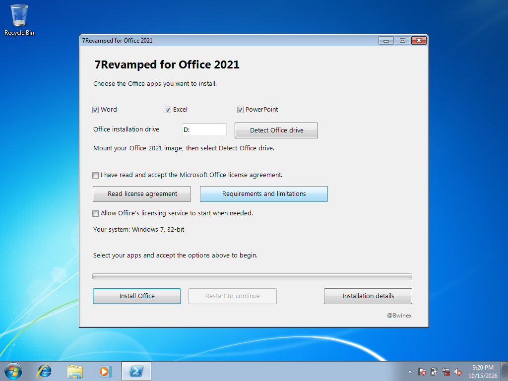

# 7Revamped

### Office 2021 on Windows 7 — a compatibility research project by @Bwinex

I started with a practical question: could Word and Excel from Office 2021 run on Windows 7? The project grew into **7Revamped for Office 2021**, a guided installer for 32-bit and 64-bit Windows 7 SP1, with PowerPoint added along the way.

My aim is to make the setup easier to follow and document what works, what fails, and what still needs testing. This repository is the public research showcase. Implementation source and internal lab records are maintained separately.

*Installer interface on Windows 7 Home Premium SP1, 32-bit. An open installer window demonstrates the interface; application results are recorded separately below.*

**[Research story](RESEARCH.md)** · **[Tested results](TESTING.md)** · **[Installation walkthrough](INSTALLATION.md)** · **[v0.7 changes](CHANGELOG.md)** · **[Credits](CREDITS.md)**

## What it does

- Lets you choose Word, Excel and PowerPoint.
- Detects 32-bit or 64-bit Windows and selects matching preparation components.
- Checks installation files and the Office media drive.
- Saves installation progress and guides you through restarts.

Office applications install in **32-bit on either Windows architecture**. The research uses Windows 7 **SP1** and the English **ProPlus2021Retail build 16.0.16327.20264**. Other Office builds and languages are not interchangeable with the tested setup.

## Current milestone: v0.7

v0.7 adds a compiled welcome launcher, compiled readiness checks and clearer interface wording. I completed a manual installation on Windows 7 Ultimate SP1 x64 and reported that it worked. That run does not yet have the same detailed delayed-edit, save and reopen record as earlier tests. The full [test matrix](TESTING.md) separates versions and evidence levels.

## Downloads

**No public installer download is available here yet.** The current research package includes third-party components whose redistribution terms and notices still need review. This showcase does not distribute Office or Windows installation media, activation tools, or the private source repository.

GitHub's **Code → Download ZIP** downloads these documents and screenshots, not an installer. The [installation walkthrough](INSTALLATION.md) describes the current workflow for people who already have an authorized research package.

## Known limits

This is independent compatibility research, not a Microsoft-supported Office configuration. Optional PowerPoint AI helpers are disabled, and some newer touch/WinRT features remain unavailable or unvalidated. Physical PCs, other hypervisors, printers, add-ins, large documents and every Office feature have not been covered by the recorded tests.

Normal Office licensing requirements still apply. The project does not activate Office.

## Share feedback

Use [Issues](https://github.com/huzbag/7Revamped-showcase/issues) to share questions, ideas or a reproducible problem. Include Windows edition, SP1 status, 32/64-bit architecture, kit version, application and steps taken. Remove personal information from screenshots and logs; do not post product keys or passwords.

Project direction and hands-on testing: **@Bwinex**. External compatibility work is credited in [CREDITS.md](CREDITS.md).
